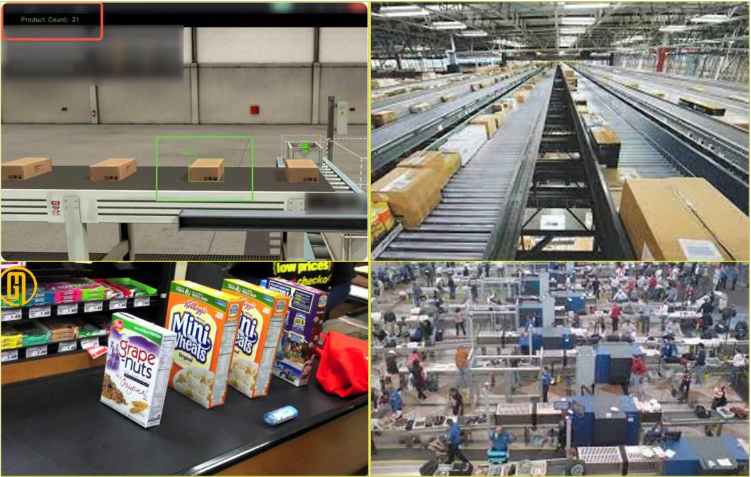
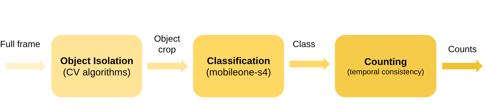
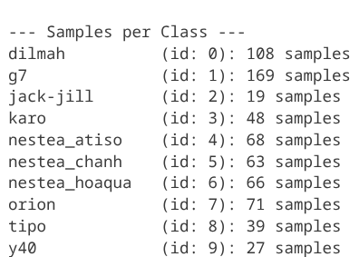
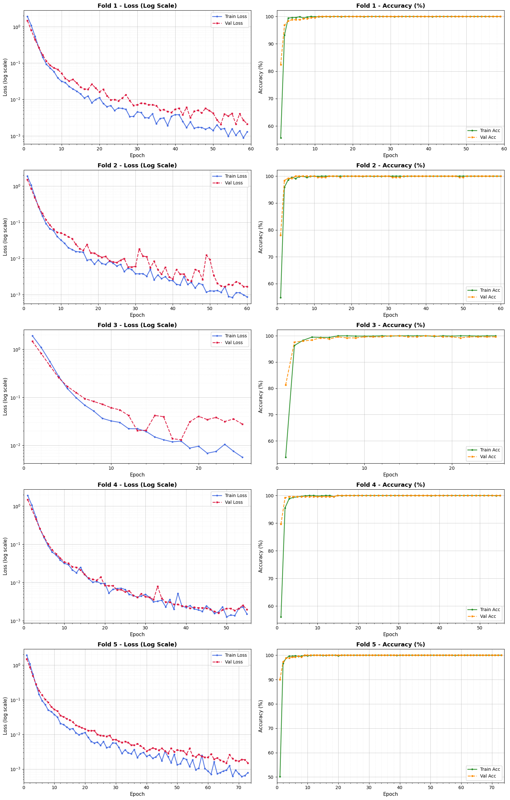
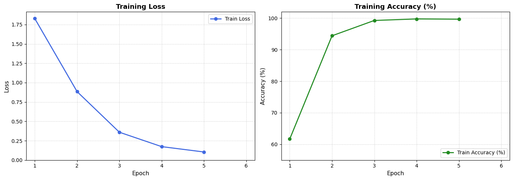
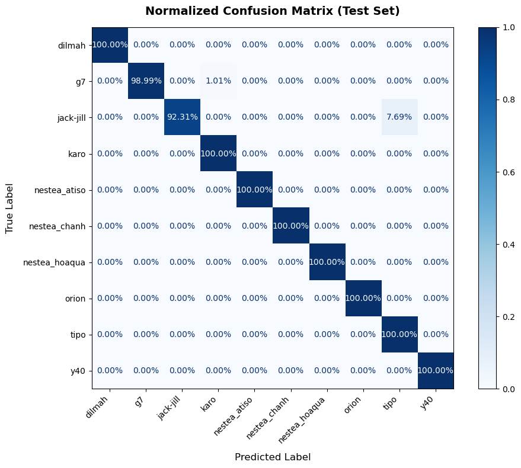
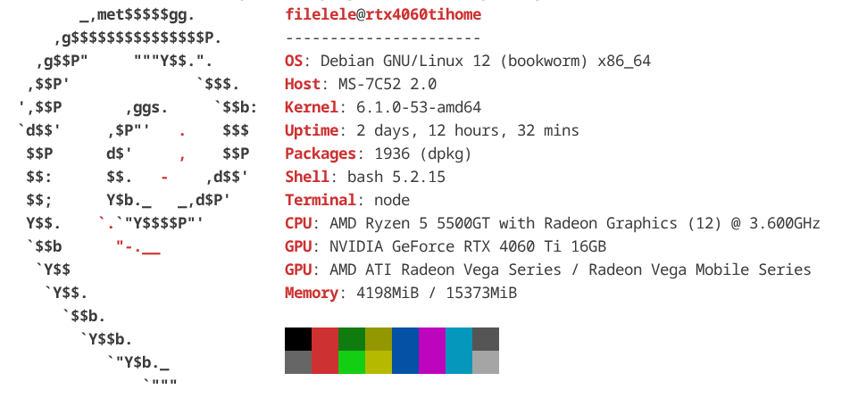

<h1 align="center">Object Counter on Belt conveyor</h1>

https://github.com/user-attachments/assets/29df744f-0154-450d-9bb3-bb5285eaaa30

## Problem statement

Currently, many manufacturing factories need to automate product counting and identification, such as:
- Production lines in the factory
- Product classification/packaging lines of logistics companies
- The process of importing/exporting warehouses, buying and selling products of supermarkets, etc.

<p align="center">
  
</p>

Figure shows a simple conveyor system, consisting of the following 
components: 
- Conveyor belt
- The camera is fixed above, looking down at the conveyor belt.
- Objects are confectionery products. 

## Goals
- Classify objects moving on the conveyor belt.
- Count the number of each class.
- Display result.

## Solution Overview


## Installation & Quick Start

### 1. Environment Setup
```bash
conda env create -f environment.yaml
conda activate ars-trg-sp1_mini-project
```

### 2. Run Inference
1. Place input video into `inference/` (e.g. `inference/video_test_1.avi`).
2. Run the inference pipeline:
   ```bash
   cd inference
   python infer.py
   ```
3. The annotated video with live counts will be saved to `inference/output/output_counted.mp4`.

> **Note on Debug Mode:**
> In `infer.py`, `debug=True` runs without artificial delays for fast offline processing. Set `debug=False` in `main(debug=False)` to simulate real-time camera streaming paced strictly by video FPS.
## Solution details

### Dataset

- Data are video records of 10 types (10 classes) of product samples.


There are two types of recording for each class:

<table>
  <tr>
    <td align="center" width="50%">
      <b>Cellphone video</b><br>
      <sub>Recorded using a cellphone on plain blue or grainy gray background</sub>
    </td>
    <td align="center" width="50%">
      <b>Conveyor video</b><br>
      <sub>Taken from real conveyor belt system</sub>
    </td>
  </tr>
  <tr>
    <td align="center" valign="top">
      
      
    </td>
    <td align="center" valign="top">
      
    </td>
  </tr>
</table>

### Data preprocessing

- **Background removal**: Raw frames are dominated by background, which wastes resources and hurts classification. Custom pipelines crop the background for each video type ([cellphone notebook](dataset/cellphone_img_processing.ipynb), [conveyor notebook](dataset/conveyor_img_processing.ipynb)), with the conveyor pipeline also used during live inference.
- **Deduplication**: Consecutive video frames contain heavy duplication, which causes overfitting and data leakage across splits. SSIM-based similarity filtering is used to sample unique frames ([deduplication notebook](dataset/deduplicate_cropped_frames.ipynb)). 

After preprocessing, the cropped and leaned dataset:



### Classification & Fine-Tuning

Because the target products share visual characteristics with common classes in **ImageNet-1K** (on which MobileOne was pre-trained), full re-training from scratch was unnecessary. Instead, transfer learning via fine-tuning was performed on **MobileOne-S4**, freezing early representations and selectively unfreezing only:
- **Stage 4** convolutional blocks (higher-level feature extraction)
- **Linear classification head** (mapping to the 10 target classes)

#### Training Setup

- **Dataset Split**: 75% train / 25% test split with stratified sampling.
- **Class Imbalance**: Handled via `WeightedRandomSampler` during batch creation.
- **Optimizer**: AdamW (`lr=1e-4`, `weight_decay=1e-2`) applied to trainable parameters:

#### K-Fold Validation ($k=5$)

A 5-fold stratified cross-validation was conducted to verify training stability across data subsets before committing to final weights:



**Observations:**
- **Rapid Convergence**: Distinct packaging characteristics across the 10 classes allow the model to reach >50% accuracy on epoch 1, converging near-instantly across all folds.
- **Early Stopping Decision**: Because validation loss plateaued rapidly, the final training run on the full train split was intentionally capped at ***5 epochs*** (~0.10 cross-entropy loss) to prevent memorization and overfitting.

#### Final train result


Loss land nicely at expected value, at around 0.1.

#### Test result

Since object detection and frame rejection are handled upstream by the conveyor cropping pipeline, the classification model operates on segmented crops. In a multi-class counting system, misclassifying Class $A$ as Class $B$ simultaneously produces a False Positive for $B$ (overcounting) and a False Negative for $A$ (undercounting).

To evaluate performance without bias toward majority classes, we evaluate using:
- **Macro-averaged Precision, Recall, and F1-Score** (treating all product lines equally).
- **Confusion Matrix** to identify any pairwise visual confusion between similar packaging designs.

| Metric | Score |
| :--- | :--- |
| **Accuracy** | 99.13% |
| **Macro Precision** | 0.9922|
| **Macro Recall** | 0.9913 |
| **Macro F1-Score** | 0.9915 |



Fail cases:

<p align="center">
  
  
  
</p>

Failed only on severe motion blur or glare, which are rare in deployed hardware setup. Also, the wrongly predicted class is visually similar to the actual class.

### Pipeline latency

Pipeline processing consists of mainly 2 parts: Object cropping and classification. The benchmark as below:

Latency:
- Crop time: 1.3333 ms
- Crop time (with object): 1.7473 ms
- Classification time: 5.3675 ms
- E2E time: 8.9352 ms

Hardware: 


